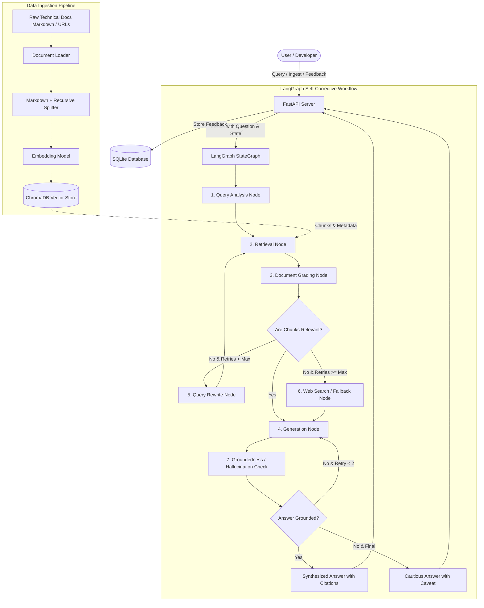

# System Architecture Document

## 1. High-Level Architecture Overview

The system is organized into four distinct architectural layers:
1. **Client / Interface Layer**: REST API clients, Swagger UI, and an interactive modern Web Interface.
2. **Application & API Layer (FastAPI)**: Endpoint routing, input validation, session management, and response serialization.
3. **Orchestration & Cognitive Engine (LangGraph)**: Stateful graph-based execution implementing self-corrective RAG with query rewriting, document grading, conditional routing, generation, and hallucination verification.
4. **Data & Storage Layer**:
   - **Vector Store (ChromaDB)**: High-dimensional embeddings and chunk metadata.
   - **Document Store / Ingestion Engine**: Markdown/HTML loaders and recursive chunkers.
   - **Persistence Store (SQLite)**: User feedback, query logs, and conversation memory.



---

## 2. LangGraph StateGraph Architecture

### 2.1 Graph State Schema (`GraphState`)

The state schema defines all variables tracked across nodes. It is implemented using `typing.TypedDict` or Pydantic:

```python
from typing import List, Optional, Literal
from typing_extensions import TypedDict

class DocumentChunk(TypedDict):
    content: str
    metadata: dict  # source, title, header_path, chunk_id
    relevance_score: Optional[str]  # "relevant" | "irrelevant"
    reasoning: Optional[str]

class GraphState(TypedDict):
    question: str                      # Original user query
    current_query: str                 # Current query (original or rewritten)
    query_type: Optional[str]          # conceptual | how-to | troubleshooting | api_reference
    chat_history: List[dict]           # [{"role": "user", "content": "..."}, ...]
    documents: List[DocumentChunk]      # Candidate retrieved documents
    relevant_documents: List[DocumentChunk] # Documents passing grading
    generation: Optional[str]          # Generated answer
    sources: List[dict]                # Formatted source citations
    retry_count: int                   # Number of rewrites executed
    max_retries: int                   # Maximum allowed retries (default: 2)
    hallucination_grade: Optional[str] # "grounded" | "hallucinated"
    fallback_used: bool                # True if web search or fallback invoked
```

### 2.2 Node Deep Dive

#### Node 1: Query Analysis (`query_analysis_node`)
- **Purpose**: Normalize raw input, expand synonyms, resolve references from chat history, and determine the technical intent.
- **Output**:
  - `query_type`: Categorized into `conceptual`, `how-to`, `troubleshooting`, or `api_reference`.
  - `current_query`: Expanded search query optimized for embedding retrieval.

#### Node 2: Retrieval (`retrieve_node`)
- **Purpose**: Query ChromaDB using vector similarity search with MMR (Maximal Marginal Relevance) for maximum diversity and relevance.
- **Output**: `documents` populated with top-$k$ ($k=4$) chunks along with headers and metadata.

#### Node 3: Document Grading (`grade_documents_node`)
- **Purpose**: Implements the **CRAG (Corrective RAG)** document filter. Evaluates each retrieved document chunk individually using an LLM evaluator with structured output.
- **Evaluation Criteria**: Does the document contain keywords, code snippets, or semantic concepts directly relevant to answering the user's question?
- **Output**:
  - `relevant_documents`: Filtered subset containing only high-confidence chunks.
  - Irrelevant chunks are discarded.

#### Node 4: Query Rewriting (`rewrite_query_node`)
- **Purpose**: Invoked when zero documents pass the relevance threshold and `retry_count < max_retries`.
- **Transformation**: Analyzes why retrieval failed, strips noisy phrasing, introduces technical synonyms, and increments `retry_count += 1`.
- **Target Edge**: Routes back to `retrieve_node`.

#### Node 5: Web Search / Fallback (`web_search_fallback_node`)
- **Purpose**: Invoked when retries are exhausted with no internal corpus match.
- **Action**: Queries external web search API (e.g. Tavily / DuckDuckGo search) to fetch public documentation, or constructs a clear "Not found in technical documentation" response.

#### Node 6: Answer Generation (`generate_node`)
- **Purpose**: Synthesizes the final answer using strictly the validated relevant documents.
- **Grounding & Citation Rules**:
  - Must only state facts present in context.
  - Every technical assertion and code sample must cite its source (e.g. `[FastAPI Tutorial - Dependencies]`).
  - Synthesizes clear markdown with syntax-highlighted code blocks.

#### Node 7: Hallucination Check (`hallucination_check_node`)
- **Purpose**: Evaluates whether the generated response is strictly grounded in the retrieved context (inspired by Self-RAG).
- **Output**: `hallucination_grade: "grounded" | "not grounded"`.
- **Edge Routing**: If grounded, route to `END`. If hallucinated, triggers regeneration with strict negative constraints.

---

## 3. Document Ingestion Pipeline & Chunking Strategy

### 3.1 Technical Documentation Corpus Selection
For the demonstration corpus, we provide 4 high-value, comprehensive technical documentation suites:
1. **FastAPI Core Guides**: Dependency Injection, Routing, Asynchronous Endpoints, Security.
2. **LangGraph Fundamentals**: StateGraph, Nodes, Conditional Edges, Human-in-the-Loop.
3. **Pydantic v2 Architecture**: BaseModels, Field Validation, Serialization, Model Config.
4. **HTTP & API Best Practices**: Status codes, REST principles, idempotency.

### 3.2 Two-Tier Chunking Strategy
Technical documentation has distinct hierarchical structure (headers, code blocks, tables). Standard naive character splitting cuts code blocks in half and separates explanatory text from headings.

Our two-tier chunking pipeline solves this:
1. **Tier 1 - Semantic Header Splitter (`MarkdownHeaderTextSplitter`)**:
   - Splits on `#`, `##`, `###`.
   - Every chunk inherits its full breadcrumb hierarchy (`{"H1": "Dependencies", "H2": "Sub-dependencies"}`) as metadata.
2. **Tier 2 - Recursive Code-Preserving Splitter (`RecursiveCharacterTextSplitter`)**:
   - Splits oversized sections with chunk size of 800 tokens and 150 token overlap.
   - Respects Markdown code fence boundaries (````python ... ````), double newlines, and sentence breaks.

### 3.3 Vector Store Schema (ChromaDB)
- **Collection Name**: `technical_docs`
- **Embedding Function**: HuggingFace / FastEmbed `all-MiniLM-L6-v2` (384 dimensions) or OpenAI `text-embedding-3-small`.
- **Metadata Fields**:
  - `source`: File path or URL
  - `document_name`: E.g. "fastapi_dependencies.md"
  - `header_path`: Hierarchical section path (e.g. "FastAPI > Dependencies > Yield")
  - `chunk_id`: Unique deterministic hash (UUID5 based on content and source)
  - `ingested_at`: ISO timestamp

---

## 4. REST API Specification (FastAPI)

### 4.1 Endpoints

| Method | Path | Request Body | Response Body | Description |
|---|---|---|---|---|
| `POST` | `/api/v1/query` | `QueryRequest` | `QueryResponse` | Submit user question, runs LangGraph pipeline, returns answer with citations |
| `POST` | `/api/v1/ingest` | Multipart or `IngestRequest` | `IngestResponse` | Ingests new markdown/txt files or fetches from URLs |
| `GET` | `/api/v1/documents` | None | `DocumentListResponse` | Lists all indexed documents, chunk statistics, and metadata |
| `POST` | `/api/v1/feedback` | `FeedbackRequest` | `FeedbackResponse` | Records user feedback (upvote/downvote and comments) to SQLite |
| `GET` | `/api/v1/health` | None | `HealthResponse` | Verifies LLM connectivity and vector store index state |

### 4.2 Data Models (Pydantic v2)
```python
from pydantic import BaseModel, Field
from typing import List, Optional, Literal

class QueryRequest(BaseModel):
    question: str = Field(..., min_length=2, max_length=1000)
    session_id: Optional[str] = Field(None, description="Session ID for chat memory")

class Citation(BaseModel):
    source: str
    header_path: str
    snippet: str

class QueryResponse(BaseModel):
    answer: str
    query_type: str
    sources: List[Citation]
    retries_used: int
    grounded: bool
    fallback_used: bool
    session_id: str

class FeedbackRequest(BaseModel):
    query_id: str
    rating: Literal["up", "down"]
    comment: Optional[str] = None
```

---

## 5. Storage & Persistence
- **ChromaDB**: Persisted in local directory `./data/chroma_db/`. Survives service restarts.
- **SQLite Database**: Persisted in `./data/app_storage.db` storing:
  - `queries`: `(id, session_id, question, answer, query_type, retries, created_at)`
  - `feedback`: `(id, query_id, rating, comment, created_at)`
  - `documents`: `(id, source_name, source_type, total_chunks, created_at)`
